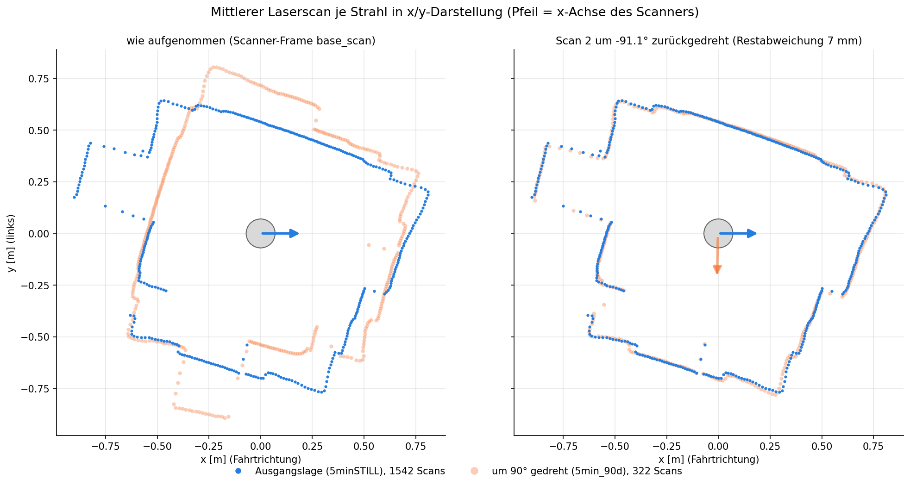
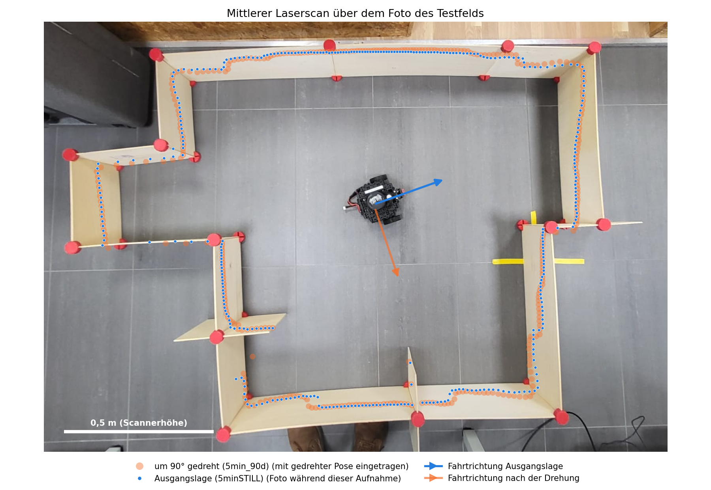
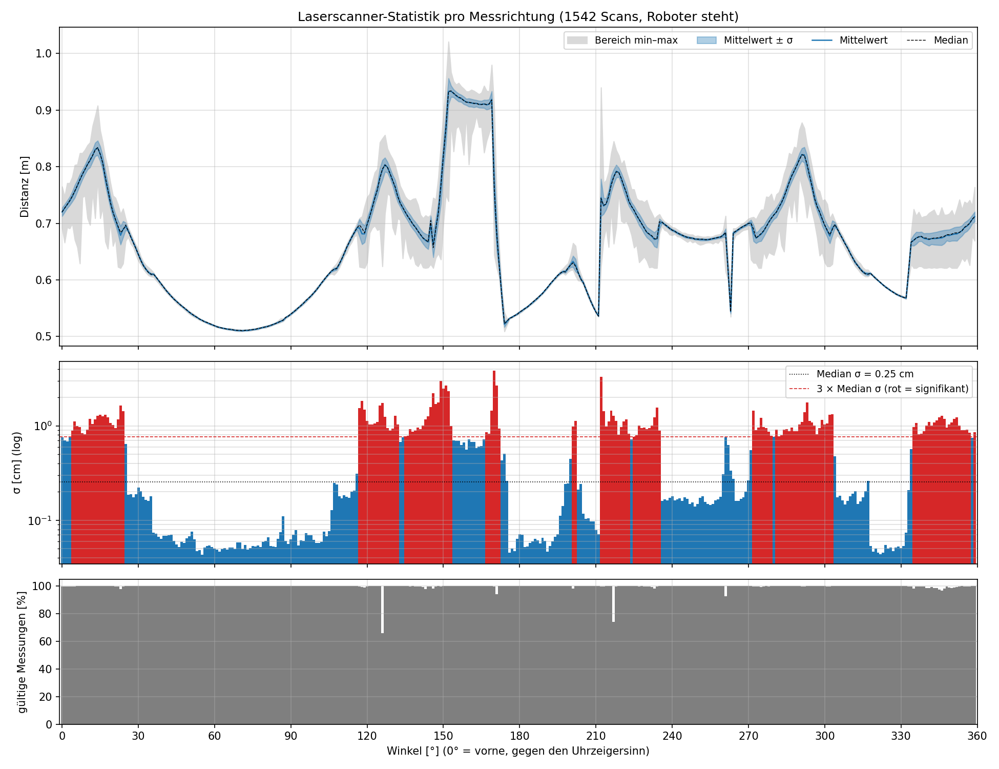
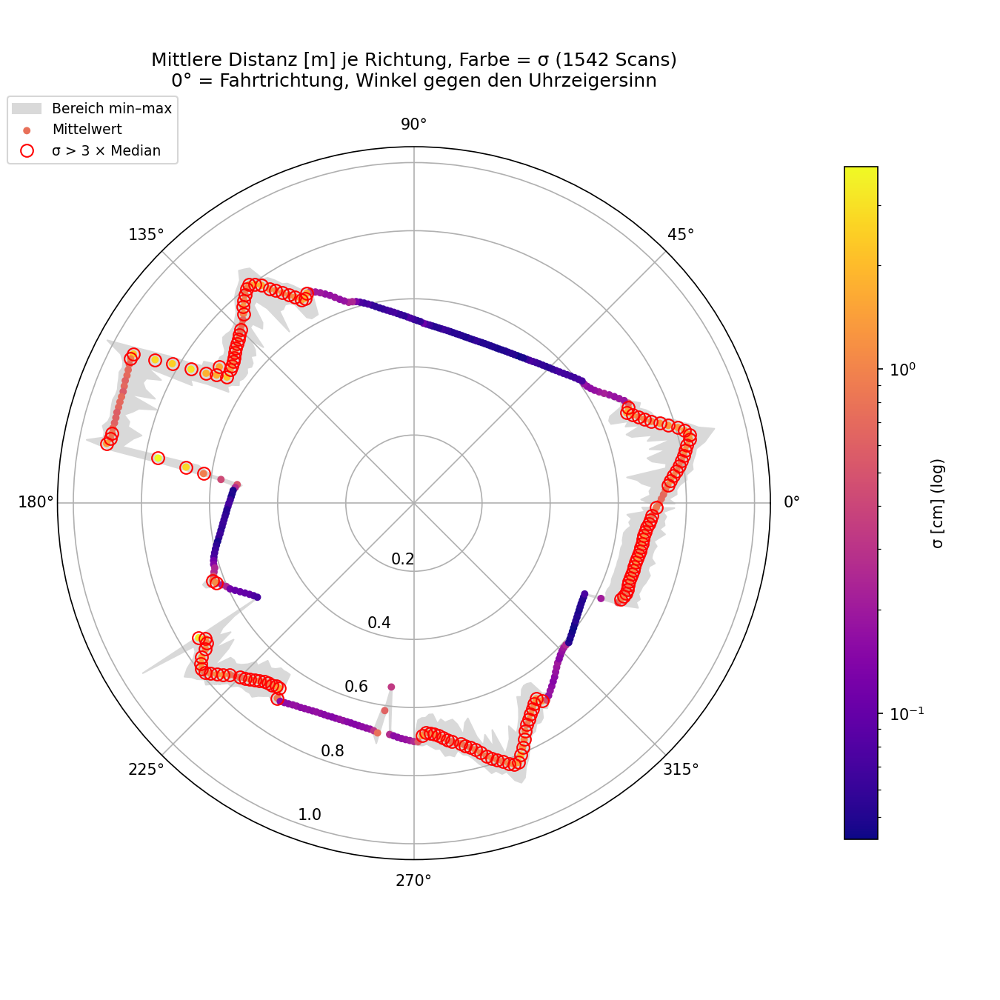
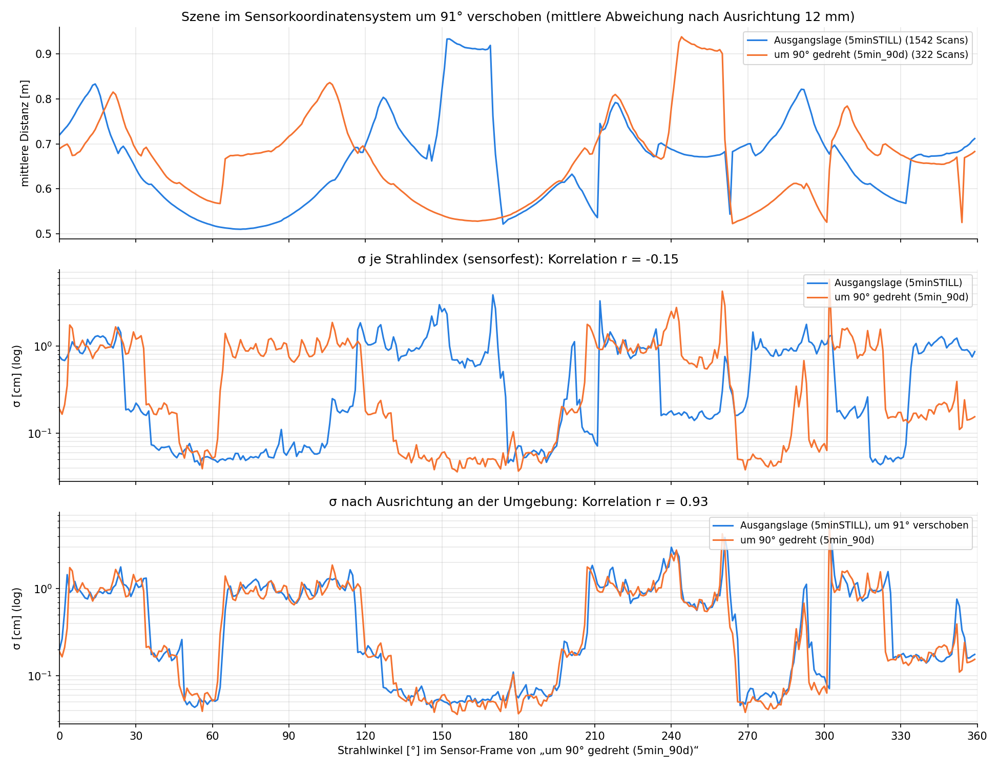
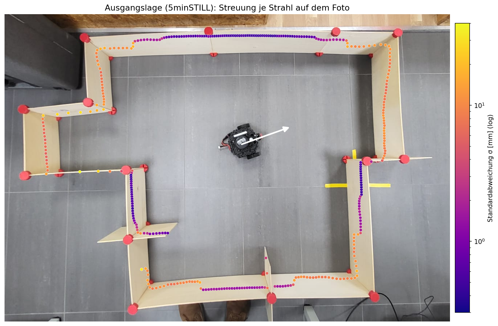
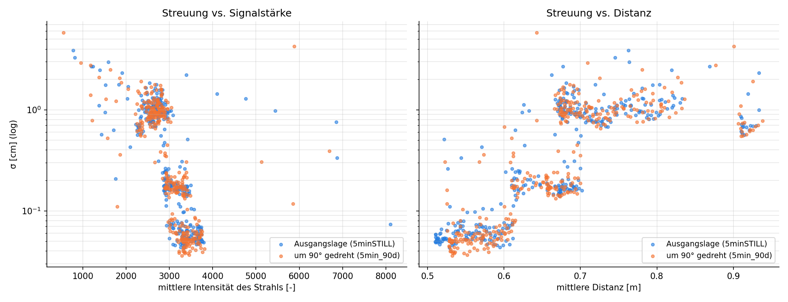
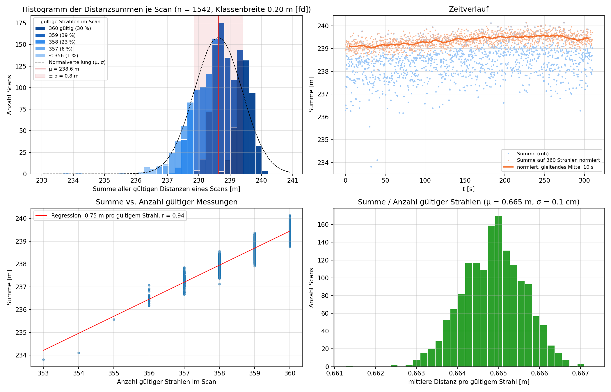
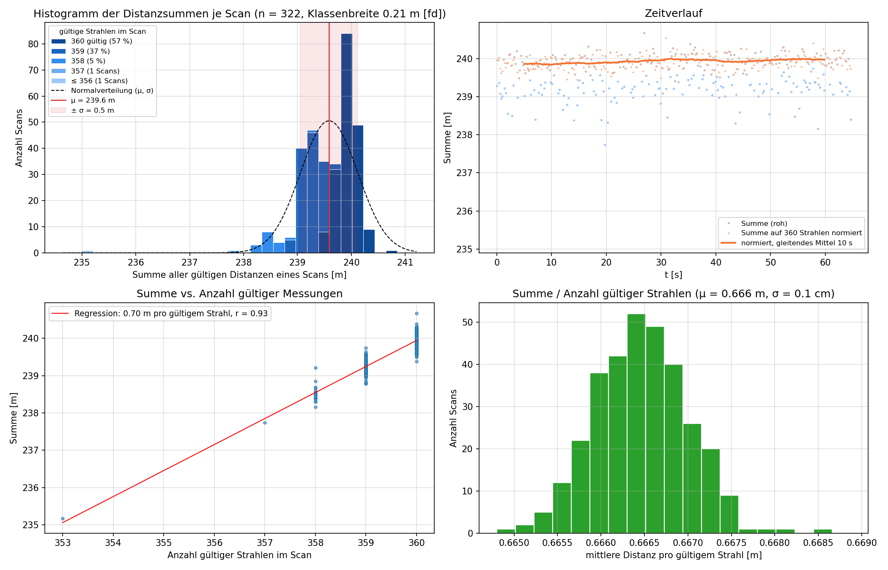

# Laserscanner-Statistik – Punkt 4 und 5

**Messdaten (Aufnahme vom 26.11., Rescue-Testfeld, Roboter steht)**

| | `subset_5minSTILL` | `subset_5min_90d` |
|---|---|---|
| Situation | Ausgangslage | Roboter auf der Stelle um ≈ 90° gedreht |
| Dauer / Scans | 309,6 s / 1542 Scans | 64,6 s / 322 Scans |
| Scanrate | 4,98 Hz | 4,97 Hz |
| Strahlen je Scan | 360 (0°…359°, Auflösung 1°) | 360 |
| Messbereich laut `/scan` | 0,12 m … 3,5 m | 0,12 m … 3,5 m |
| gültige Messwerte | 99,69 % | 99,86 % |

Als ungültig gelten Werte, die der LDS-01 als 0 liefert (kein Echo) oder die außerhalb von
`[range_min, range_max]` liegen. Diese Werte werden nicht in die Statistik aufgenommen, sondern
gezählt (`n_valid`). In der Aufnahme `5minSTILL` liefern die Strahlen 333°/334° zehnmal einen
Wert von 0,04 m, also unterhalb von `range_min`. Das sind Fehlechos, sie werden ebenfalls
verworfen.

Die Auswertung erfolgt mit den Nodes `scan_statistics` und `scan_sum`. Für die Bags wird dieselbe
Berechnung (`Scripts/excercise_1/excercise_1/laser_core.py`) mit `Scripts/analyze_scan_bag.py` direkt auf die
Bagdatei angewendet. So geht beim Abspielen keine Best-Effort-Nachricht verloren und alle Scans
werden berücksichtigt.

### Darstellung der Scans in x/y und über dem Foto

Für die Darstellung wird für jeden der 360 Strahlen die mittlere Distanz bestimmt und in
kartesische Koordinaten umgerechnet: x = r·cos θ, y = r·sin θ (Scanner-Frame `base_scan`,
x = Fahrtrichtung, y = links).



Links sind beide Scans so dargestellt, wie der Scanner sie aufgenommen hat. Der zweite Scan ist
schwächer eingezeichnet. Die Umgebung erscheint darin um ≈ 90° gedreht. Rechts wurde der zweite
Scan durch eine Punkt-zu-Punkt-Registrierung zurückgedreht. Der Roboter wurde demnach um
**91,1° im Uhrzeigersinn** gedreht und dabei nur um ≈ 1 cm verschoben. Nach dieser Korrektur
liegen beide Scans mit einer Restabweichung von 7 mm deckungsgleich übereinander.



Für die Überlagerung mit dem Foto (`Images/Turtlebot3_TopView.jpeg`, aufgenommen während `5minSTILL`)
wurde eine Ähnlichkeitstransformation bestimmt: Position des Scanners im Bild, Richtung der
x-Achse und Maßstab. Die Parameter wurden so angepasst, dass die Scanpunkte auf den Holzwänden
liegen. Ergebnis: Maßstab 591 px/m auf Scannerhöhe, x-Achse 19,6° gegen den Uhrzeigersinn ab
Bild-rechts. Das passt zur Ausrichtung des Roboters im Foto, die anhand der Radachse auf ≈ 18°
geschätzt wurde. 99 % der Scanpunkte liegen danach auf den Wänden. Auch kleine Details sind im
Scan zu erkennen, etwa die dünne Querplatte unten in der Mitte (einzelne Punkte bei 262°) und
die Nische links. Der gedrehte Scan ist mit der Pose nach der Drehung eingetragen. Er liegt auf
denselben Wänden, nur die Fahrtrichtung (Pfeil) ist um 91° gedreht.

---

## 4. Mittelwert, Varianz und Standardabweichung je Messrichtung

### Berechnung

Für jede Messrichtung *i* (i = 0 … 359) werden über alle *N<sub>i</sub>* gültigen Messungen
*r<sub>i,k</sub>* berechnet:

- Mittelwert: μ<sub>i</sub> = (1/N<sub>i</sub>) · Σ<sub>k</sub> r<sub>i,k</sub>
- Varianz (Stichprobe): s<sub>i</sub>² = 1/(N<sub>i</sub> − 1) · Σ<sub>k</sub> (r<sub>i,k</sub> − μ<sub>i</sub>)²
- Standardabweichung: σ<sub>i</sub> = √s<sub>i</sub>²

Zusätzlich werden Median, Minimum, Maximum und der Anteil gültiger Messungen gespeichert
(`Results/5minSTILL_scan_statistics.csv`, `Results/5min_90d_scan_statistics.csv`).

### Plots (Ordner `Images/`)

- `5minSTILL_scan_statistics_plot.png`: Mittelwert ± σ und min–max je Winkel, σ (log.), gültige Messungen
- `5minSTILL_scan_statistics_polar.png`: Mittelwert in Polardarstellung, Farbe = σ
- `5minSTILL_scan_statistics_std_vs_dist.png`: σ über der mittleren Distanz
- dieselben Plots mit Präfix `5min_90d_` für die gedrehte Aufnahme
- `vergleich_5min_ausrichtung.png`: σ beider Aufnahmen, sensorfest und an der Umgebung ausgerichtet
- `vergleich_5min_sigma_intensitaet.png`: σ über Intensität und Distanz




### Ergebnisse

| | 5minSTILL | 5min_90d |
|---|---|---|
| Median σ über alle Strahlen | 2,5 mm | 2,2 mm |
| Mittelwert σ | 5,8 mm | 5,7 mm |
| kleinstes σ | 0,4 mm | 0,4 mm |
| größtes σ | 38,6 mm (170°) | 58,2 mm (302°) |
| Strahlen ohne gültige Messung | 0 | 0 |
| Strahlen mit Aussetzern | 75 | 39 |
| schlechteste Strahlen (Anteil gültig) | 126° (66 %), 217° (74 %) | 217° (86 %), 292° (89 %) |

Die Standardabweichung ist nicht gleichmäßig verteilt. Sie bildet vier deutlich getrennte Gruppen:

| Gruppe | Strahlen (STILL) | Median σ | typische Distanz | mittlere Intensität |
|---|---|---|---|---|
| sehr ruhig | 108 | 0,6 mm | 0,51 – 0,61 m | > 3300 |
| ruhig | 79 | 1,7 mm | 0,61 – 0,70 m | 3000 – 3300 |
| erhöht | 165 | 9,7 mm | 0,67 – 0,93 m | 2000 – 3000 |
| Ausreißer (σ ≥ 2 cm) | 8 | 27 mm | an Sprungstellen | meist < 2000 |

Die Plots zeigen also signifikante Abweichungen in einzelnen Richtungen. Wählt man als Schwelle
das Dreifache des Medians (≈ 0,7 mm), liegen 142 Strahlen (90°-Aufnahme: 154) darüber. Das sind
fast genau die Gruppen „erhöht“ und „Ausreißer“.

### Interpretation

**1. Die Abweichungen gehören zur Umgebung, nicht zu bestimmten Sensorrichtungen.**
Um das zu prüfen, wurde der Roboter zwischen den beiden Aufnahmen auf der Stelle gedreht. Die
mittleren Distanzprofile sind danach um 91 Strahlen gegeneinander verschoben, die Szene erscheint
also um 91° versetzt (Restabweichung nach dem Verschieben: 12 mm). Vergleicht man σ bei gleichem
Strahlindex (sensorfest), korrelieren die beiden Aufnahmen nicht (r = −0,15). Verschiebt man die
Ausgangslage um 91°, also auf dieselbe Wand ausgerichtet, liegen die Kurven fast deckungsgleich
übereinander (r = 0,93; Plot `vergleich_5min_ausrichtung.png`). Die erhöhte Streuung wandert also
mit der Szene mit. Ein defekter oder schlecht kalibrierter Winkelbereich des Scanners kann
damit ausgeschlossen werden.



**2. Die Streuung hängt von Distanz und Einfallswinkel ab.**
Laut Foto bestehen alle Wände aus denselben hellen Sperrholzplatten, ein Materialunterschied
scheidet als Ursache also aus. Die Darstellung von σ auf dem Foto (`scan_xy_foto_sigma.png`)
zeigt ein klares Muster. Am ruhigsten (≈ 0,5 mm) sind die Abschnitte, die nahe am Roboter liegen
und fast senkrecht getroffen werden: die Mitte der oberen Wand, die linke untere Platte und die
Mitte der unteren Wand. Dieser Wert entspricht der Auflösung des Sensors, denn die Werte sind auf
1 mm quantisiert und springen nur zwischen 2–3 benachbarten Millimeterwerten. Weiter entfernte
oder schräg getroffene Abschnitte streuen um ≈ 1 cm, also etwa 20-mal stärker. Das sind die
Enden der oberen Wand, die Ecken, die Nische links und die rechte Wand. Die rechte Wand streut
auch dort stark, wo sie senkrecht getroffen wird (≈ 0,72 m). Die Distanz wirkt also auch ohne
schrägen Einfall. Die Übergänge zwischen den Stufen sind scharf und liegen meist an Knicken im
Distanzprofil, also an Plattenstößen oder leicht gewölbten Platten. log(σ) korreliert mit der
Distanz (r = 0,78) und mit der Intensität (r = −0,59). Distanz und Einfallswinkel lassen sich
mit diesen Daten nicht vollständig trennen, weil die weiter entfernten Abschnitte meist auch die
schräg getroffenen sind.



Physikalisch passt das
Verhalten zum Messprinzip des LDS-01 (Triangulation): Bei schwächerem und breiterem Lichtfleck
auf dem Empfänger wird dessen Position ungenauer bestimmt, und die Distanzauflösung nimmt mit der
Entfernung ab. Dass die Streuung sprunghaft statt stetig zunimmt, deutet zusätzlich auf eine
interne Verarbeitung im Sensor hin, zum Beispiel eine Umschaltung von Belichtung oder Verstärkung
abhängig von der Signalstärke. Das lässt sich aus den Daten allein aber nicht belegen.



**3. Die größten Abweichungen liegen an Kanten (Mischpixel).**
Alle Strahlen mit σ ≥ 2 cm (STILL: 146°, 149–152°, 170–171°, 212°) liegen an Sprungstellen der
Distanz, also an Kanten von Wandelementen oder am Eingang der Nische bei 150–170°. Der
Laserfleck hat eine endliche Breite und trifft dort teilweise die vordere Kante und teilweise
die dahinterliegende Wand. Der Messwert springt deshalb zwischen beiden Distanzen hin und her
oder liegt dazwischen (Strahl 212°: 0,62 m … 0,94 m, Strahl 170°: 0,64 m … 0,90 m). Diese
Strahlen haben meist eine geringe Intensität (170°/212°: ≈ 800, 149–152°: 1200–1900, auf den
ruhigen Flächen dagegen > 3000). Da die Drehung nicht exakt 90° um das Scanner-Zentrum war, trifft nach der Drehung ein
anderer Strahl die Kante genau. Deshalb unterscheiden sich die beiden Aufnahmen vor allem an
diesen Stellen (z. B. 302° in der gedrehten Aufnahme mit σ = 5,8 cm).

**4. Aussetzer treten bei schwachem Echo auf.**
Im Mittel fehlen 1,1 (STILL) bzw. 0,5 (90°) von 360 Werten pro Scan, und zwar fast nur bei
Strahlen mit geringer Intensität (126°: 1500; 171°: 1200). Kein Strahl fällt dauerhaft aus.

**5. Zeitliches Verhalten.**
Die Abweichungen aufeinanderfolgender Scans sind unkorreliert (Autokorrelation bei Verschiebung
um einen Scan ≈ 0,0). Das Rauschen ist damit zeitlich „weiß“, und eine Mittelung über *N* Scans
verringert σ um den Faktor √*N*. Benachbarte Strahlen innerhalb eines Scans sind dagegen
korreliert (r ≈ 0,45). Über die 5 Minuten zeigt sich eine kleine Drift: Der mittlere Messwert
steigt in den ersten ≈ 4 Minuten um ≈ 1,3 mm und steigt danach nicht weiter. Wahrscheinlich ist
das eine Erwärmung des Sensors. Die Drift ist im Vergleich zur Streuung der meisten Strahlen
vernachlässigbar.

**6. Vergleich mit dem Datenblatt.**
ROBOTIS gibt für den LDS-01 zwischen 0,5 m und 3,5 m eine Präzision von ±3,5 % an, bei 0,7 m also
≈ ±25 mm. Alle Strahlen außer den Kantenstrahlen bleiben deutlich darunter. Selbst die Gruppe
„erhöht“ liegt bei ≈ 1,4 % der Distanz.

**Folgerung:** Ein konstantes Sensormodell (gleiches σ für alle Strahlen) beschreibt den Scanner
schlecht. Für Kartierung und Lokalisierung sollten Strahlen mit geringer Intensität und Strahlen
an Sprungstellen schwächer gewichtet oder verworfen werden.

---

## 5. Histogramm der Distanzsummen je Scan

### Berechnung

Der Node `scan_sum` addiert für jeden Scan *k* alle gültigen Entfernungswerte:
S<sub>k</sub> = Σ<sub>i gültig</sub> r<sub>i,k</sub>. Zusätzlich speichert er die Anzahl gültiger
Strahlen *n<sub>k</sub>* (`Results/*_scan_sums.csv`). Das Histogramm erstellt
`Scripts/plot_scan_histogram.py`. Die Balken sind nach der Anzahl gültiger Strahlen im Scan
eingefärbt (gestapelt).




### Ergebnisse

| | 5minSTILL | 5min_90d |
|---|---|---|
| Scans | 1542 | 322 |
| Mittelwert μ | 238,62 m | 239,59 m |
| Median | 238,69 m | 239,74 m |
| Standardabweichung σ | 0,77 m (0,3 % von μ) | 0,53 m (0,2 %) |
| Minimum … Maximum | 233,82 … 240,14 m | 235,18 … 240,68 m |
| Scans mit allen 360 Strahlen gültig | 30 % | 57 % |
| Aussetzer pro Scan (Mittel) | 1,1 | 0,5 |
| σ der Summe bei gleicher Anzahl gültiger Strahlen | 0,25 m | 0,19 m |
| Summe / Anzahl gültiger Strahlen | 0,665 m, σ = 0,8 mm | 0,666 m, σ = 0,5 mm |

### Diskretisierung

Die Klassenbreite wurde nach der Freedman-Diaconis-Regel gewählt:
h = 2 · IQR · n<sup>−1/3</sup> = 2 · 1,14 m · 1542<sup>−1/3</sup> ≈ **0,20 m**. Das ergibt 33 Klassen,
bei der gedrehten Aufnahme 0,21 m und 28 Klassen. Diese Regel ist robust gegenüber den wenigen
Ausreißern am linken Rand. Zum Vergleich: Scott ergibt 0,23 m, Sturges 0,55 m. Die Wahl ist
durch die Struktur der Daten begründet:

- Jeder fehlende Strahl verschiebt die Summe um ≈ 0,7 m. Die Klassenbreite muss deutlich kleiner
  sein, sonst verschmelzen die Gruppen. Mit Sturges (0,55 m) wäre das der Fall.
- Innerhalb einer Gruppe streut die Summe mit σ ≈ 0,25 m. Eine Klasse von ≈ 0,2 m löst diese
  Breite gerade noch auf.
- Mit 0,1 m Klassenbreite enthalten die Klassen zu wenige Scans. Das Histogramm wird zackig und
  zeigt dann eher Zufallsschwankungen als die Verteilung.
- Die Auflösung der Einzelwerte (1 mm) begrenzt die Wahl nicht.

### Interpretation

**1. Der Scanner ist als Ganzes sehr wiederholgenau.** Die Summe von 360 Distanzen schwankt nur um
0,3 % (σ = 0,77 m bei μ = 238,6 m). Normiert auf einen Strahl beträgt die mittlere Distanz
0,665 m mit einer Streuung von nur 0,8 mm.

**2. Das Histogramm ist keine einfache Normalverteilung.** Es ist linksschief und besteht aus
mehreren überlagerten Gruppen, eine für jede Anzahl gültiger Strahlen (360, 359, 358 …). Fehlt
ein Strahl, fehlt dessen Distanz in der Summe. Die Regression ergibt 0,75 m pro fehlendem Strahl.
Das entspricht der Distanz der aussetzenden Strahlen (126°: 0,79 m; 217°: 0,78 m). Die Aussetzer
erklären 89 % der Varianz der Summe (r = 0,94). Der lange linke Ausläufer stammt von den wenigen
Scans mit 4–7 Aussetzern. Die gedrehte Aufnahme hat weniger Aussetzer. Ihr Histogramm ist deshalb
schmaler (σ = 0,53 m) und ihr Mittelwert höher.

**3. Bei gleicher Anzahl gültiger Strahlen ist die Verteilung annähernd normal**, mit
σ ≈ 0,25 m. Wären die Fehler der Einzelstrahlen unabhängig, würde man nur
√(Σ σ<sub>i</sub>²) = 0,16 m erwarten. Die größere Streuung bestätigt, dass benachbarte Strahlen
eines Scans gemeinsam schwanken (vgl. Punkt 4).

**4. Zeitverlauf.** Die auf 360 Strahlen normierte Summe (10-s-Mittel) steigt von 239,1 m bis
t ≈ 250 s auf 239,6 m (≈ 1,3 mm pro Strahl) und fällt danach leicht ab, siehe rechts oben im
Histogramm-Plot. Diese langsame Drift verbreitert das Histogramm geringfügig. Sie ist vermutlich
die Aufwärmphase des Sensors.

**5. Vergleich der beiden Aufnahmen.** Auch wenn nur vollständige Scans verglichen werden,
unterscheiden sich die Summen leicht (239,46 m bzw. 239,94 m, also 0,2 %). Der Grund ist, dass
der Roboter nicht exakt um das Scanner-Zentrum gedreht wurde und der Scanner danach an einer
etwas anderen Position stand.

**Folgerung:** Die Summe aller Distanzen eignet sich als einfacher „Fingerabdruck“ einer
statischen Szene, etwa um Veränderungen wie eine hereinkommende Person zu erkennen. Ein einzelner
Aussetzer ändert die Rohsumme allerdings schon um ≈ 0,7 m. Robuster ist deshalb die Summe pro
gültigem Strahl (mittlere Distanz, σ = 0,8 mm) oder eine Summe, in der fehlende Strahlen durch
ihren Mittelwert ersetzt werden.

---

*Quelle Datenblatt: ROBOTIS e-Manual, LDS-01 Specifications,
https://emanual.robotis.com/docs/en/platform/turtlebot3/appendix_lds_01/*

*Reproduzieren (im Repo-Ordner, nach `source /opt/ros/jazzy/setup.bash`; CSVs landen in
`Results/`, Bilder in `Images/`):*

```bash
python3 Scripts/analyze_scan_bag.py subset_5minSTILL
python3 Scripts/analyze_scan_bag.py subset_5min_90d
python3 Scripts/plot_scan_statistics.py Results/5minSTILL_scan_statistics.csv
python3 Scripts/plot_scan_histogram.py  Results/5minSTILL_scan_sums.csv
python3 Scripts/compare_scan_bags.py subset_5minSTILL subset_5min_90d \
    --labels "Ausgangslage (5minSTILL)" "um 90° gedreht (5min_90d)"
python3 Scripts/plot_scan_overlay.py subset_5minSTILL subset_5min_90d
```
